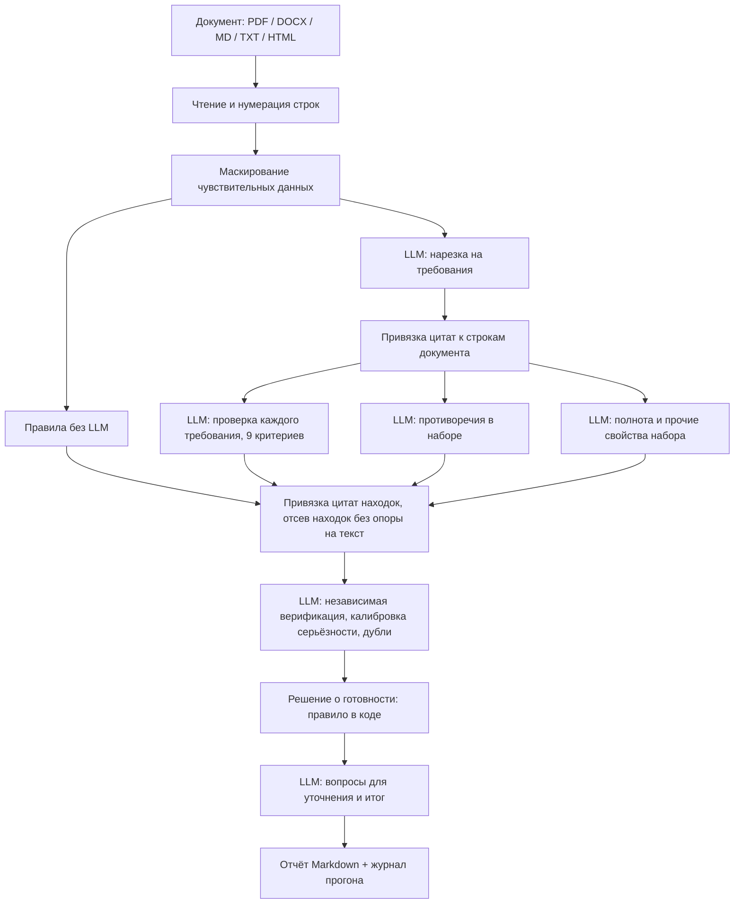

# Агент проверки требований

ИИ-агент для статического ревью документа с требованиями до начала разработки. Читает документ (PDF, DOCX, Markdown, TXT, HTML), выделяет отдельные требования, проверяет каждое и весь набор по ISO/IEC/IEEE 29148:2018 (п. 5.2.5, 5.2.6) и IEEE Std 830-1998 (п. 4.3), формулирует вопросы для уточнения и пишет отчёт на русском языке.

Задача: BCC-HUB x MNU FinTech Hackathon, «Агент проверки требований».

## Быстрый старт

**1. Ключ модели.** Откройте [aistudio.google.com/apikey](https://aistudio.google.com/apikey), войдите аккаунтом Google и нажмите «Create API key». Бесплатного тарифа достаточно.

**2. Установка** (Python 3.10+):

```bash
git clone https://github.com/i-oeng/bcc-ai.git
cd bcc-ai
python -m venv .venv
# Windows: .venv\Scripts\activate    Linux/macOS: source .venv/bin/activate
pip install -r requirements.txt
```

**3. Конфиг.** Скопируйте `.env.example` в `.env` и вставьте ключ:

```bash
cp .env.example .env        # Windows: copy .env.example .env
# в .env: GEMINI_API_KEY=ваш_ключ
```

Файл `.env` в git не попадает (см. `.gitignore`).

**4. Прогон одной командой:** путь к документу и путь к отчёту.

```bash
python -m validator samples/requirements.pdf reports/report.md
```

Отчёт ляжет в `reports/report.md`. Журнал прогона (что ушло в модель и что она ответила, структурированный `result.json`) ляжет в `runs/<дата-время>/`. Если путь к отчёту не указан, отчёт пишется в `reports/<имя документа>_report.md`.

Прогон занимает 5-10 минут: агент делает 8-9 запросов к модели. Каждый ответ модели кэшируется в `.cache/`: если прогон прервался (лимит, перегрузка модели), повторите ту же команду, и агент продолжит с места сбоя, не расходуя квоту на уже выполненные шаги. Для полностью нового прогона добавьте `--no-cache`.

## Модель

По умолчанию **`gemini-3.6-flash`** (Google Gemini API, бесплатный тариф): на момент сдачи это самая сильная модель, стабильно доступная бесплатно. Модель задаётся в `.env` (`GEMINI_MODEL`) или флагом `--model`.

**Запасная цепочка.** Бесплатные модели бывают перегружены (ответ 503), а у бесплатного тарифа есть дневной лимит (для flash-моделей 20 запросов в сутки на модель, сброс в полночь по тихоокеанскому времени, то есть в 13:00 по Алматы). Поэтому если основная модель недоступна, шаг автоматически уходит на следующую из `GEMINI_FALLBACK_MODELS` (по умолчанию `gemini-3.8-flash`, `gemini-4-hydrogen`, `gemini-3.5-flash-lite`, `gemma-4-31b-it`). Какая модель ответила на каждый шаг, видно в паспорте отчёта и в `runs/<прогон>/result.json`.

Список моделей, доступных вашему ключу:

```bash
python -m validator --list-models
```

## Как устроен агент



Ключевые решения:

* **Нет общих фраз без привязки к тексту.** Модель обязана цитировать документ дословно. Код ищет каждую цитату в документе (точно, затем нечётко) и подставляет настоящий фрагмент с номером строки, разделом и страницей. Требование или находка без найденной цитаты отбрасываются, и это видно в отчёте.
* **Гибрид правил и LLM.** Детерминированные правила ловят то, что надёжнее найти кодом: размытые слова («в момент», «и далее»), незаполненные поля шаблона, отсутствие версии и приоритетов, смешение денежных единиц, изменяющие операции через GET, коды ответа без описания. LLM ищет смысловые дефекты: противоречия между требованиями и критериями приёмки, пропущенные сценарии, непроверяемые формулировки.
* **Два взгляда на каждую находку.** Отдельный проход модели работает как независимый рецензент: отклоняет домыслы, калибрует серьёзность, объединяет дубли. Отклонённые находки не пропадают молча: они перечислены в приложении к отчёту.
* **Цикл уточнения, а не только список дефектов.** Агент готовит закрытые вопросы заказчику и смежным командам с вариантами ответа, приоритетом и адресатом, принимает ответы обратно (`--answers`), закрывает устранённые дефекты, пересчитывает готовность и может выпустить исправленную редакцию документа (`--fix`).
* **Встраивается в процесс банка.** Если в документе есть шаблонный чек-лист ревью, агент заполняет его по результатам проверки; покрытие функциональных требований критериями приёмки выводится таблицей.
* **Устойчивость к бесплатному тарифу.** Запасная цепочка моделей, повторы при перегрузке, кэш ответов с продолжением после сбоя. Если последний шаг недоступен, отчёт всё равно пишется: итог составляется правилом, а в паспорте появляется предупреждение.
* **Решение принимает код, а не модель.** «Можно ли начинать разработку» определяется правилом по подтверждённым находкам (есть критичный дефект, значит нельзя). Модель только объясняет решение и расставляет приоритеты исправлений.

## Конфиденциальность

Банковские требования часто содержат то, что нельзя отправлять во внешний сервис. Поэтому перед любым запросом к модели документ проходит маскирование на этой машине:

| Что ищется | Как проверяется |
| :--- | :--- |
| Номера карт | регулярное выражение + алгоритм Луна |
| ИИН / БИН | контрольный разряд по алгоритму РК |
| IBAN | контрольная сумма mod 97 |
| Телефоны, e-mail, IP, URL с хостом | регулярные выражения |
| Токены и ключи (JWT, Bearer, API-ключи, пароли в строках) | сигнатуры |
| ФИО | нейросеть Natasha (работает офлайн) + шаблоны «Фамилия И.О.» |
| Свои термины (названия систем, хосты) | список в файле `REDACT_TERMS_FILE` |

* Значение заменяется плейсхолдером (`[КАРТА_1]`, `[ФИО_2]`). Одно значение всегда получает один плейсхолдер, поэтому модель понимает, что речь об одной карте.
* Таблица соответствий не покидает машину; в отчёте исходные значения возвращаются на место.
* **Fail closed:** перед каждым запросом исходящий текст сканируется ещё раз. Если что-то осталось, запрос не отправляется.
* **Аудит:** `python -m validator документ.pdf --dry-run` ничего не отправляет в модель, а сохраняет в `runs/` маскированный документ и первый запрос ровно в том виде, в каком они ушли бы. Все запросы реального прогона тоже сохраняются в `runs/`.
* Суммы, даты, пороги и коды ответа не маскируются: без них нельзя проверить логику требований.

Ограничение: маскирование скрывает идентификаторы, но не бизнес-логику. Для документов, где конфиденциальна сама логика, нужен платный тариф Gemini (Google не использует такие данные для обучения) или корпоративный контур.

Пример маскирования: `python -m validator samples/requirements_with_pii.md --dry-run`.

## Отчёт

Отчёт на русском, в Markdown. В начале блок «Кратко» на один экран: готовность к разработке и тестированию, главные дефекты, вопросы, которые задать первыми.

1. **Паспорт прогона:** документ, SHA-256 файла, дата, модель (и версия, которую вернул API), версия агента (git-коммит), статистика маскирования и запросов.
2. **Как агент нарезал требования:** таблица «ID в отчёте, ID в документе, место, краткая формулировка, цитата».
3. **Проверка каждого требования:** матрица 9 критериев и находки с цитатой, местом и исправлением (блоки без критичных находок свёрнуты).
4. **Проверка всего набора:** оценка по 8 критериям набора, таблица покрытия функциональных требований критериями приёмки (какие сценарии не проверяются), находки.
5. **Вопросы для уточнения:** блокирующие, важные, желательные; кому задать, почему важно, варианты ответа; учтённые ответы.
6. **Чек-лист ревью требований:** если в документе есть шаблонный чек-лист ревью банка, агент заполняет его за ревьюера (Да / Нет / Не требуется) с обоснованием и ссылками на находки.
7. **Сводка:** число требований и нарушений по серьёзности и критериям, список критичных дефектов (противоречивые, непроверяемые, неполные).
8. **Итог:** можно ли начинать разработку и тестирование, что исправить в первую очередь.

Приложения: методика, отклонённые верификатором находки, объединённые дубли, журнал исправленной редакции.

Рядом с отчётом агент кладёт `<отчёт>_questions.md`: вопросы с полями «Ответ:» для заказчика.

## Цикл уточнения и исправленная редакция

```bash
# 1. проверка: отчёт + файл вопросов reports/report_questions.md
python -m validator samples/requirements.pdf reports/report.md

# 2. заказчик вписывает ответы после «Ответ:» (текстом или номером варианта)

# 3. повторная проверка с ответами и исправленной редакцией документа
python -m validator samples/requirements.pdf reports/report.md --answers reports/report_questions.md --fix
```

На шаге 3 агент определяет, какие дефекты ответы закрывают, помечает их в отчёте «Закрыто ответом заказчика» и пересчитывает готовность. Остальные шаги берутся из кэша, поэтому повтор стоит 2-3 запроса к модели. С `--fix` агент пишет `<отчёт>_fixed.md`: исправленную редакцию документа с журналом изменений по ID находок. Бизнес-решений агент не принимает: где нужен выбор заказчика, а ответа нет, в тексте стоит `[УТОЧНИТЬ: …]`. Исправленную редакцию можно проверить тем же агентом и сравнить число дефектов до и после.

## Веб-интерфейс

```bash
python -m web            # открыть http://127.0.0.1:8000
```

То же, что командная строка, в браузере: выбор примера или загрузка своего файла, предпросмотр маскирования (что уйдёт в модель, без запросов к ней), запуск с журналом в реальном времени, результат по вкладкам (итог, отчёт, нарушения с фильтрами, требования, вопросы, чек-лист и покрытие, паспорт, файлы), ответы заказчика прямо в форме и повторная проверка, история прогонов, сравнение «до и после».

Интерфейс работает поверх HTTP API (`web/api.py`, описание и схемы на `/docs`), поэтому фронтенд можно заменить, не трогая агента. Сервер слушает только этот компьютер; документ адресуется идентификатором (`sample:…`, `upload:…`), а не путём, так что прочитать произвольный файл через API нельзя. Одновременно идёт один прогон (общая квота модели). Если ключа нет в `.env`, его можно вписать в настройках страницы: он передаётся заголовком `X-Gemini-Key` только при запуске и на диск не пишется. Загруженные документы и отчёты интерфейса лежат в `runs/` (не попадает в git).

## Критерии

| Уровень | Критерии | Источник |
| :--- | :--- | :--- |
| Требование | необходимость, уместность уровня, однозначность, полнота, единичность, выполнимость, проверяемость, корректность, соответствие оформлению | ISO/IEC/IEEE 29148 п. 5.2.5; IEEE 830 п. 4.3 |
| Набор | полнота, непротиворечивость, выполнимость, понятность, возможность валидации, прослеживаемость, ранжирование, модифицируемость | ISO/IEC/IEEE 29148 п. 5.2.6; IEEE 830 п. 4.3 |

Серьёзность: критично (блокирует разработку или тесты), существенно (высокий риск неверной реализации), незначительно (оформление).

## Параметры

```text
python -m validator ВХОД [ОТЧЁТ] [--answers FILE] [--fix] [--model M] [--fallback M1,M2] [--batch-size N]
                    [--dry-run] [--no-redact] [--no-cache] [--list-models] [--rerender RUN_DIR]
```

* `--answers FILE`: учесть ответы заказчика из файла вопросов.
* `--fix`: сформировать исправленную редакцию документа.
* `--dry-run`: ничего не отправлять в модель, показать маскированный документ и первый запрос.
* `--no-cache`: не брать ответы из кэша.
* `--rerender runs/<прогон>`: перерисовать отчёт из сохранённого прогона без запросов к модели.

| Переменная `.env` | Назначение | По умолчанию |
| :--- | :--- | :--- |
| `GEMINI_API_KEY` | ключ Gemini | обязательно |
| `GEMINI_MODEL` | модель | `gemini-3.6-flash` |
| `GEMINI_FALLBACK_MODELS` | запасные модели через запятую | `gemini-3.8-flash,gemini-4-hydrogen,gemini-3.5-flash-lite,gemma-4-31b-it` |
| `GEMINI_TEMPERATURE` | температура | значение модели |
| `REDACT_ENABLED` | маскирование | `1` |
| `REDACT_NER` | поиск ФИО через Natasha | `1` |
| `REDACT_TERMS_FILE` | файл своих терминов для маскирования | не задан |
| `VALIDATOR_BATCH_SIZE` | требований в одном запросе | `12` |
| `VALIDATOR_CACHE` | кэш ответов модели (продолжение после сбоя) | `1` |
| `VALIDATOR_TZ` | часовой пояс даты в паспорте | `Asia/Almaty` |

## Качество

Тесты (без сети, с поддельной моделью):

```bash
python -m pytest -q
```

Оценка полноты по размеченному вручную эталону дефектов (`eval/gold.json`):

```bash
python eval/score.py runs/<прогон>/result.json
```

## Структура

```text
validator/
  cli.py        командная строка
  pipeline.py   конвейер проверки
  clarify.py    файл вопросов и разбор ответов заказчика
  loader.py     чтение PDF/DOCX/MD/TXT/HTML, номера строк, разделы, страницы
  redact.py     маскирование и проверка исходящих запросов
  llm.py        клиент Gemini: JSON-схемы, повторы, журнал запросов
  prompts.py    промпты
  criteria.py   критерии ISO 29148 и IEEE 830, шкала серьёзности
  rules.py      детерминированные проверки
  grounding.py  привязка цитат к строкам документа
  report.py     отчёт
web/
  api.py        HTTP API и раздача фронтенда (python -m web)
  services.py   логика интерфейса: документы, прогоны, история, ответы, сравнение
  jobs.py       фоновые прогоны с журналом
  static/       фронтенд без сборки (index.html, app.js, style.css)
  static/fonts/ EB Garamond (SIL OFL 1.1): свободная замена ITC Garamond, если его нет в системе
samples/        документ хакатона (MD и PDF) и пример с персональными данными
reports/        отчёт итогового прогона
eval/           эталон дефектов и скрипт оценки
tests/          тесты
```
