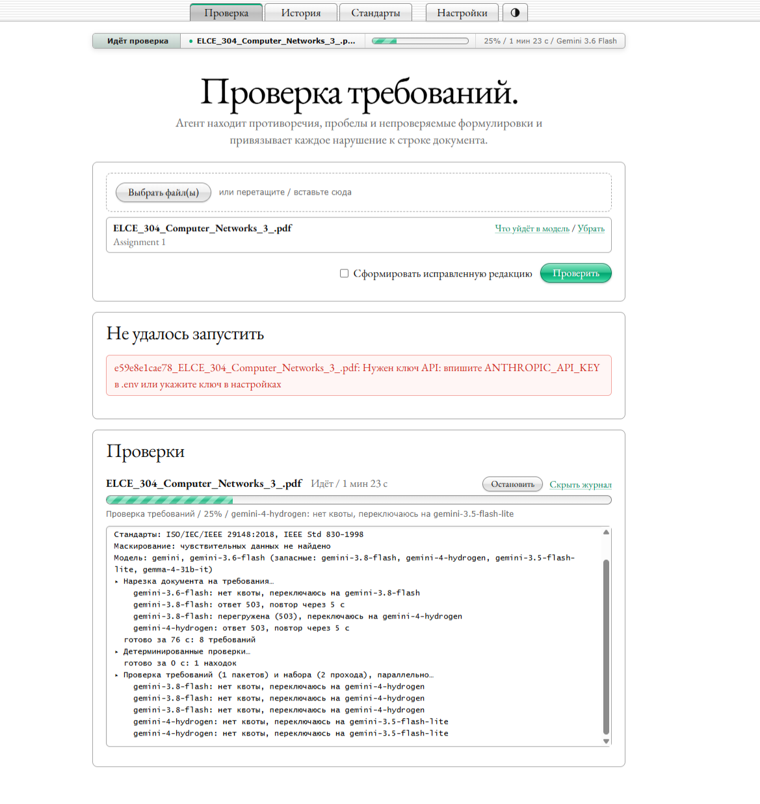
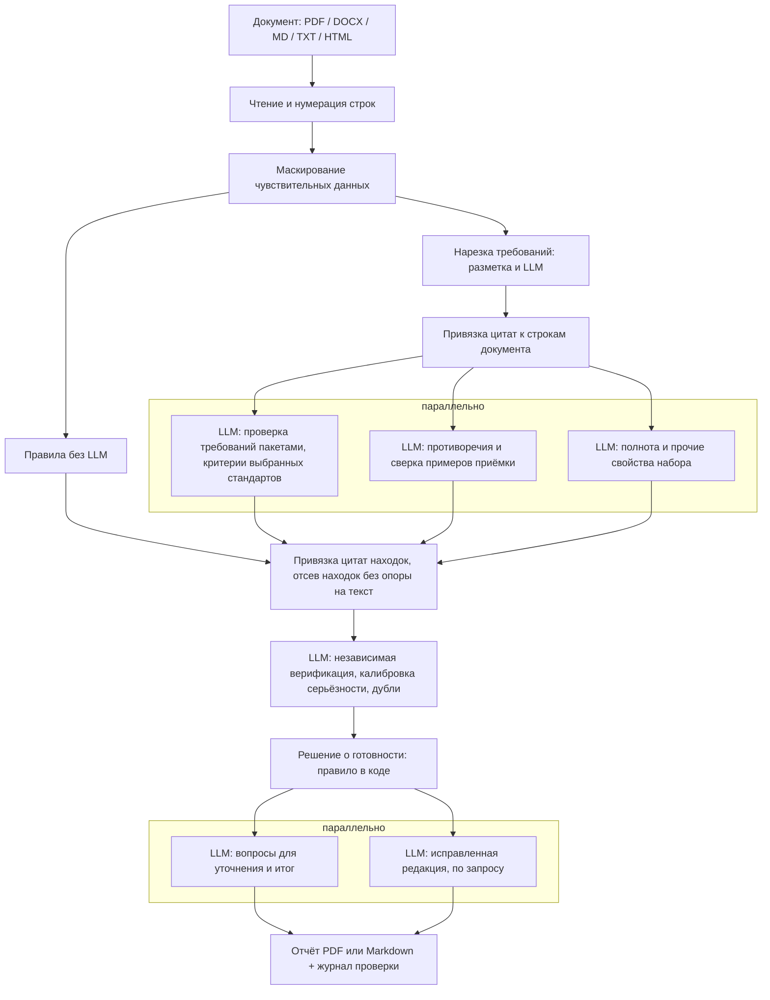

# Oresa

Агент проверки требований

[Открыть Oresa в браузере](https://forteveriti.tail8331b7.ts.net:8443/#/check) · [Скачать PDF-отчёт по документу организаторов](reports/report.pdf)



ИИ-агент для статического ревью документа с требованиями до начала разработки. Читает документ (PDF, DOCX, Markdown, TXT, HTML), выделяет отдельные требования, проверяет каждое и весь набор по ISO/IEC/IEEE 29148:2018 (п. 5.2.5, 5.2.6) и IEEE Std 830-1998 (п. 4.3), по желанию также по INCOSE GtWR, EARS, ISO/IEC 25010 и ГОСТ 34.602, формулирует вопросы для уточнения и пишет отчёт на русском языке. Работает с Google Gemini, Anthropic Claude и любым OpenAI-совместимым API.

Задача: BCC-HUB x MNU FinTech Hackathon, «Агент проверки требований».

## Запуск одной командой

```
python main.py --input samples\requirements.pdf --output reports\report.pdf --format pdf --provider gemini --model gemini-3.6-flash --api-key ВАШ_КЛЮЧ
```

Команда одинаково работает в cmd, PowerShell и bash (в bash пути через `/`). Флаги можно писать с одним или двумя дефисами.

**Что нужно заранее:** Python 3.10+, зависимости `pip install -r requirements.txt` (подробно в «Быстром старте» ниже) и ключ Gemini: бесплатно на [aistudio.google.com/apikey](https://aistudio.google.com/apikey). Вместо `--api-key` ключ можно положить в `.env` (`GEMINI_API_KEY=...`), тогда флаг не нужен.

| Флаг | Что делает | По умолчанию |
| :--- | :--- | :--- |
| `--input` | документ с требованиями: PDF, DOCX, MD, TXT, HTML | обязателен |
| `--output` | файл отчёта; расширение `.pdf` или `.md` задаёт формат | `reports/<имя документа>_report.pdf` |
| `--format` | `pdf`, `md` или `both` (оба файла сразу) | по расширению `--output`, иначе PDF |
| `--provider` | `gemini`, `anthropic` или `openai` (и совместимые: Ollama, vLLM, OpenRouter) | `LLM_PROVIDER` из `.env`, иначе `gemini` |
| `--model` | модель провайдера; список доступных вашему ключу: `--list-models` | `gemini-3.6-flash` |
| `--api-key` | ключ модели прямо в команде; важнее `.env`, в модель не отправляется | ключ из `.env` |
| `--questions-file` | дополнительно записать форму вопросов с полями для ответов | выключено (вопросы и так есть в отчёте) |
| `--answers ФАЙЛ` | повторная проверка с ответами заказчика: закрывает устранённые дефекты | |
| `--fix` | дополнительно сформировать исправленную редакцию документа | выключено |
| `--standards` | дополнительные стандарты: `ieee830`, `incose_gtwr`, `ears`, `iso25010`, `gost34602` | ISO 29148 и IEEE 830 |
| `--dry-run` | ничего не отправлять в модель, только показать, что ушло бы (после маскирования) | |
| `--no-cache` | полностью новая проверка, без ответов модели из кэша | кэш включён |

**Что получится.** Один файл отчёта на русском (по умолчанию PDF формата A4, строгое чёрно-белое оформление): решение, можно ли начинать разработку и тестирование; паспорт прогона; итог и что исправить в первую очередь; сводка с показателями качества и графиками; вопросы заказчику; проверка набора и каждого требования; как агент нарезал требования. Журнал проверки (что ушло в модель и что она ответила, `result.json`) ложится в `runs/<дата-время>/`.

**Сколько ждать.** Обычно от 30 секунд до 5 минут, в зависимости от размера документа и модели; когда бесплатный тариф перегружен, дольше (наш худший замер 9 минут). Если у основной модели кончилась квота или она перегружена, агент сам переключается на запасные модели, а в паспорте отчёта видно, какие модели ответили на самом деле. Прерванная проверка продолжается с места сбоя той же командой.

**Опора на документ.** Каждое нарушение, требование и вопрос в отчёте опирается на цитату, найденную в документе; ссылки на строки и номера сверяет код, а неподтверждённое удаляется до отчёта. Перед отправкой в модель номера карт, ИИН, IBAN, телефоны, e-mail, токены и ФИО заменяются метками.

**Коды завершения:** `0` отчёт готов; `1` ошибка модели (ключ, квота, сеть), сообщение подскажет, что сделать; `2` документ нельзя прочитать (повреждён, пустой, защищён паролем, только сканы): агент всё равно пишет отчёт с диагностикой и ничего не отправляет в модель.

## Итоговый отчёт

Отчёт агента по документу организаторов ([`docs/requirements.md`](https://github.com/BCC-HUB/ai-requirements-validator-task/blob/main/docs/requirements.md), в репозитории тот же файл лежит как `samples/requirements.md`), сформирован автоматически, без ручных правок:

* [`reports/report.pdf`](reports/report.pdf), он же в Markdown: [`reports/report.md`](reports/report.md).

Итог проверки: 47 требований, 20 открытых нарушений (критичных 3, существенных 7, незначительных 10), 7 вопросов заказчику (блокирующих 3); разработку начинать нельзя. Отчёт получен одной командой `python main.py --input samples/requirements.md --output reports/report.pdf --format both --provider gemini --no-cache` 27.11.2026, проверка заняла 48 секунд. Основная модель `gemini-3.6-flash` и запасные `gemini-3.8-flash` и `gemini-4-hydrogen` в тот день исчерпали бесплатную квоту, поэтому все шаги выполнила самая лёгкая запасная модель `gemini-3.5-flash-lite` (это видно в паспорте отчёта). Сверка с эталоном заложенных дефектов (`eval/gold.json`): найдено 13 из 30, из ключевых 9 из 16. С основной моделью агент находит больше: прогон по PDF-версии того же документа нашёл 24 из 30, из ключевых 15 из 16 (тот отчёт в истории git, коммит `5482462`). Полнота отчёта упирается в модель, а не в агента: конвейер, правила и проверка опоры одинаковы для любой модели, поэтому более сильная модель способна найти все заложенные дефекты. Для максимальной полноты укажите самую сильную доступную модель, например `--provider anthropic --model claude-opus-5-5` или платную модель Gemini; на бесплатном тарифе полный набор мы пока не замеряли. Прошлые прогоны лежат в `reports/archive/`.

## Зачем это банку

* **Время.** Документ на 42 требования это около 400 отдельных проверок (9 критериев на требование и 8 на набор целиком) плюс сверка примеров приёмки с правилами. У аналитика такое ревью занимает часы (наша оценка, не замер); агент делает его за время от 2 до 5 минут и сразу выдаёт вопросы заказчику.
* **Дефекты до разработки.** Противоречие между правилом и критерием приёмки, найденное на ревью, стоит одной правки текста; найденное в тестах или в проде стоит доработки, повторного тестирования и релиза.
* **Проверяемость.** Каждое нарушение со ссылкой на страницу и строку и дословной цитатой; решение «можно ли начинать разработку» принимает правило в коде, а не модель.
* **Данные клиента не уходят наружу.** Маскирование до любого запроса, режим аудита `--dry-run`, свой сервер модели в контуре банка через OpenAI-совместимый API.

## Быстрый старт

**1. Ключ модели.** По умолчанию агент работает с Google Gemini: откройте [aistudio.google.com/apikey](https://aistudio.google.com/apikey), войдите аккаунтом Google и нажмите «Create API key». Бесплатного тарифа достаточно. Можно и другого провайдера, см. раздел «Модель».

**2. Установка** (Python 3.10+):

```bash
git clone https://github.com/i-oeng/bcc-ai.git
cd bcc-ai
python -m venv .venv
# Windows: .venv\Scripts\activate    Linux/macOS: source .venv/bin/activate
pip install -r requirements.txt
```

**3. Конфиг.** Скопируйте `.env.example` в `.env` и вставьте ключ:

```bash
cp .env.example .env        # Windows: copy .env.example .env
# в .env: GEMINI_API_KEY=ваш_ключ
```

Файл `.env` в git не попадает (см. `.gitignore`).

**4. Проверка одной командой:** путь к документу и путь к отчёту.

```bash
python main.py --input samples/requirements.pdf --output reports/report.pdf
```

То же короче: `python -m validator samples/requirements.pdf reports/report.pdf`.

Одна команда вместе с ключом, моделью и форматом и все флаги: раздел «Запуск одной командой» в начале.

Ключ из `--api-key` важнее `.env` и в модель не отправляется. Чтобы ключ не остался в истории команд, его можно передать переменной окружения: в PowerShell `$env:GEMINI_API_KEY="ВАШ_КЛЮЧ"; python main.py --input samples\requirements.pdf --output reports\report.pdf --provider gemini`, в cmd `set GEMINI_API_KEY=ВАШ_КЛЮЧ && python main.py --input samples\requirements.pdf --output reports\report.pdf --provider gemini`. Расширение `--output` задаёт формат: `.pdf` или `.md`; `--format both` пишет оба.

**Интерактивный режим:** `python main.py` без аргументов открывает сессию в терминале. Перетащите документ в окно или введите путь: агент покажет ход проверки и итог, отчёт ляжет в `reports/`. Дальше спрашивайте о результате обычными словами («почему нельзя начинать разработку?», «перепиши Ф-2») или вводите `Н-03`, `В-1`, `ТР-05`, `/findings крит`, `/questions`, `/history`, `/dry путь`, `/help`. Ctrl+C останавливает проверку после текущего шага.
 Отчёт ляжет в `reports/report.pdf`. Журнал проверки (что ушло в модель и что она ответила, структурированный `result.json`) ляжет в `runs/<дата-время>/`. Если путь к отчёту не указан, отчёт пишется в `reports/<имя документа>_report.pdf` (агент спросит формат, если запущен в терминале).

Независимые запросы к модели (пакеты требований и два прохода по набору, затем итог и исправленная редакция) идут параллельно, поэтому время проверки определяют 4 последовательных шага, а не 8-9. Каждый ответ модели кэшируется в `.cache/`: если проверка прервалась (лимит, перегрузка модели, остановка), повторите ту же команду, и агент продолжит с места сбоя, не расходуя квоту на уже выполненные шаги. Повторная проверка того же документа с теми же настройками целиком берётся из кэша за секунды. Для полностью новой проверки добавьте `--no-cache`.

## Модель

| Провайдер | `LLM_PROVIDER` | Ключ в `.env` | Модель по умолчанию |
| :--- | :--- | :--- | :--- |
| Google Gemini | `gemini` (по умолчанию) | `GEMINI_API_KEY` | `gemini-3.6-flash` |
| Anthropic Claude | `anthropic` | `ANTHROPIC_API_KEY` | `claude-opus-5-5` |
| OpenAI и совместимые (OpenRouter, DeepSeek, Groq, vLLM, Ollama) | `openai` | `OPENAI_API_KEY`, для совместимых ещё `OPENAI_BASE_URL` | `gpt-5-mini` |

Провайдер выбирается в `.env`, флагом `--provider` или в настройках веб-интерфейса; модель: `<ПРОВАЙДЕР>_MODEL` или `--model`. Ответ всегда проверяется по JSON-схеме (структурированный вывод у Gemini, OpenAI и Claude; у совместимых серверов режим JSON со схемой в инструкции). Маскирование, кэш и журнал одинаковы для всех провайдеров. Для Claude Opus 5.5 и Sonnet 5.5 включён серверный переход на запасную модель Anthropic при отказе по политике безопасности.

По умолчанию **`gemini-3.6-flash`** (Google Gemini API, бесплатный тариф): на момент сдачи это самая сильная модель, стабильно доступная бесплатно. Для скорости у моделей Gemini 3 и новее уровень размышлений по умолчанию `low` (`GEMINI_THINKING`; пусто: как у модели).

**Запасная цепочка.** Бесплатные модели бывают перегружены (ответ 503), а у бесплатного тарифа есть дневной лимит (для flash-моделей 20 запросов в сутки на модель, сброс в полночь по тихоокеанскому времени, то есть в 13:00 по Алматы). Поэтому если основная модель недоступна, шаг автоматически уходит на следующую из `GEMINI_FALLBACK_MODELS` (по умолчанию `gemini-3.8-flash`, `gemini-4-hydrogen`, `gemini-3.5-flash-lite`, `gemma-4-31b-it`). Какая модель ответила на каждый шаг, видно в паспорте отчёта и в `runs/<проверка>/result.json`.

**Стоимость.** На бесплатном тарифе Gemini проверка ничего не стоит. На платном ключе расход снижают без потери точности:

* правила без модели, нарезка размеченных требований и слияние одинаковых находок выполняются кодом, без запросов;
* требования проверяются пакетами (`--batch-size`, по умолчанию 12 за запрос), а не по одному;
* повтор той же проверки и продолжение после сбоя берутся из локального кэша ответов;
* документ, который нельзя прочитать, отсекается до модели (см. «Повреждённые и нечитаемые документы»);
* дублирующий запрос при медленном ответе (`VALIDATOR_HEDGE_SECONDS`) нужен только на перегруженном бесплатном тарифе: на платном ключе его стоит отключить (`0`), чтобы не платить за повтор;
* сколько входных токенов провайдер взял из своего кэша контекста (это дешевле), видно в паспорте отчёта.

Расход одной проверки документа хакатона (215 строк, 42 требования) на основной модели без перегрузки: 11 запросов, около 70 тыс. входных и 28 тыс. выходных токенов.

Проверенная, но не принятая идея: поставить документ в начало каждого запроса, чтобы общий префикс попадал в кэш провайдера. Одна проверка на документе хакатона дала покрытие эталона 17 из 30 против 22 из 30 при текущем порядке (проверка была в 2,5 раза быстрее, но модель пропустила часть кодов ответа API). Одного прогона мало, чтобы отличить эффект порядка от разброса модели, поэтому порядок не изменён: точность важнее экономии.

**Claude и другие модели.** Провайдер меняется одной переменной, код агента не меняется. Для Claude: `LLM_PROVIDER=anthropic` и `ANTHROPIC_API_KEY` в `.env` (или профиль `ant auth login`, тогда ключ в `.env` не нужен); модель по умолчанию `claude-opus-5-5`, глубина размышлений `ANTHROPIC_EFFORT=high`, при отказе по политике безопасности API сам повторяет запрос на запасной модели. Для своего сервера в контуре банка (Ollama, vLLM) или OpenRouter, DeepSeek, Groq: `LLM_PROVIDER=openai` и `OPENAI_BASE_URL`. В интерактивном режиме то же самое без правки файлов: `/provider claude`, `/key`, `/baseurl http://localhost:11434/v1`; модель выбирается из готового списка (`/model` показывает модели провайдера с пояснениями, `/model 2` выбирает по номеру, Tab подсказывает имена), а `/models` загружает полный список с вашего ключа или сервера. Эти команды модель не вызывают.

**Ключи в модель не попадают.** Ключ передаётся провайдеру только в заголовке запроса через его SDK. Перед каждым запросом действуют три проверки: маскирование документа (ключи Google, OpenAI, Anthropic, OpenRouter, Groq, Hugging Face, xAI, GitHub, AWS, Stripe, Slack, токены Telegram, JWT, Bearer, PEM-ключи, строки вида `password=` и `api_key=`); повторная проверка исходящего текста (Fail closed); и жёсткий запрет на значение любого настроенного ключа (`*_API_KEY`, `*_TOKEN`, `*_SECRET` из окружения и `.env`), который действует даже при `--no-redact`. Команда `/key` спрашивает ключ скрыто, пишет его только в `.env` и не сохраняет в историю ввода; строки с ключами в историю тоже не пишутся. Проверка: `python -m pytest tests/test_secrets.py -q`.

Список моделей, доступных вашему ключу:

```bash
python -m validator --list-models
```

## Как устроен агент



Ключевые решения:

* **Нет общих фраз без привязки к тексту.** Модель обязана цитировать документ дословно. Код ищет каждую цитату в документе (точно, затем нечётко) и подставляет настоящий фрагмент с номером строки, разделом и страницей. Требование или находка без найденной цитаты отбрасываются, и это видно в отчёте.
* **Гибрид правил и LLM.** Детерминированные правила ловят то, что надёжнее найти кодом: размытые слова («в момент», «и далее»), незаполненные поля шаблона, отсутствие версии и приоритетов, смешение денежных единиц, изменяющие операции через GET, коды ответа без описания. LLM ищет смысловые дефекты: противоречия между требованиями и критериями приёмки, пропущенные сценарии, непроверяемые формулировки.
* **Два взгляда на каждую находку.** Отдельный проход модели работает как независимый рецензент: отклоняет домыслы, калибрует серьёзность, объединяет дубли. Отклонённые находки не пропадают молча: они перечислены в приложении к отчёту.
* **Цикл уточнения, а не только список дефектов.** Агент готовит закрытые вопросы заказчику и смежным командам с вариантами ответа, приоритетом и адресатом, принимает ответы обратно (`--answers`), закрывает устранённые дефекты, пересчитывает готовность и может выпустить исправленную редакцию документа (`--fix`).
* **Встраивается в процесс банка.** Если в документе есть шаблонный чек-лист ревью, агент заполняет его по результатам проверки; покрытие функциональных требований критериями приёмки выводится таблицей.
* **Быстро и параллельно.** Независимые шаги одной проверки идут одновременно, а несколько документов проверяются параллельно (веб-интерфейс, до `VALIDATOR_MAX_JOBS`, остальные ждут в очереди). Любую проверку можно остановить; готовые шаги остаются в кэше.
* **Стандарты подключаются файлами.** Каждый стандарт описан JSON-файлом в `validator/standards/`: какие критерии он добавляет и на какие пункты ссылается. ISO/IEC/IEEE 29148 обязателен как базовая модель качества, остальные выбираются (`--standards ieee830,ears`, настройки интерфейса). На странице «Стандарты» встроенные стандарты можно менять, а свои добавлять вручную, загрузкой JSON или черновиком от модели. Изменённые и свои стандарты лежат в `custom_standards/` (или в папке из `VALIDATOR_STANDARDS_DIR`): файл с тем же id заменяет встроенный, встроенные файлы не меняются, и исходный стандарт возвращается одной кнопкой. Командная строка видит те же стандарты. Правка стандарта меняет промпты, поэтому старые ответы кэша к ней не подходят.
* **Устойчивость к бесплатному тарифу.** Запасная цепочка моделей, повторы при перегрузке, кэш ответов с продолжением после сбоя. Если последний шаг недоступен, отчёт всё равно пишется: итог составляется правилом, а в паспорте появляется предупреждение.
* **Решение принимает код, а не модель.** «Можно ли начинать разработку» определяется правилом по подтверждённым находкам (есть критичный дефект, значит нельзя). Модель только объясняет решение и расставляет приоритеты исправлений.

## Конфиденциальность

Банковские требования часто содержат то, что нельзя отправлять во внешний сервис. Поэтому перед любым запросом к модели документ проходит маскирование на этой машине:

| Что ищется | Как проверяется |
| :--- | :--- |
| Номера карт | регулярное выражение + алгоритм Луна |
| ИИН / БИН | контрольный разряд по алгоритму РК |
| IBAN | контрольная сумма mod 97 |
| Телефоны, e-mail, IP, URL с хостом | регулярные выражения |
| Токены и ключи (JWT, Bearer, API-ключи, пароли в строках) | сигнатуры |
| ФИО | нейросеть Natasha (работает офлайн) + шаблоны «Фамилия И.О.» |
| Свои термины (названия систем, хосты) | список в файле `REDACT_TERMS_FILE` |

* Значение заменяется плейсхолдером (`[КАРТА_1]`, `[ФИО_2]`). Одно значение всегда получает один плейсхолдер, поэтому модель понимает, что речь об одной карте.
* Таблица соответствий не покидает машину; в отчёте исходные значения возвращаются на место.
* **Fail closed:** перед каждым запросом исходящий текст сканируется ещё раз. Если что-то осталось, запрос не отправляется.
* **Аудит:** `python -m validator документ.pdf --dry-run` ничего не отправляет в модель, а сохраняет в `runs/` маскированный документ и первый запрос ровно в том виде, в каком они ушли бы. Все запросы реальной проверки тоже сохраняются в `runs/`.
* Суммы, даты, пороги и коды ответа не маскируются: без них нельзя проверить логику требований.

Ограничение: маскирование скрывает идентификаторы, но не бизнес-логику. Для документов, где конфиденциальна сама логика, нужен платный тариф провайдера (данные не используются для обучения) или свой сервер модели в контуре банка через OpenAI-совместимый API (`OPENAI_BASE_URL`, например vLLM или Ollama).

Пример маскирования: `python -m validator samples/requirements_with_pii.md --dry-run`.

## Повреждённые и нечитаемые документы

Агент не падает на плохом входе. До любого запроса к модели он проверяет файл и, если проверять нечего, пишет на место отчёта диагностику: что не так, что сделать и какие проверки пройдены. Код выхода 2, запросы к модели не отправляются.

| Вход | Что пишет агент |
| :--- | :--- |
| файла нет, указана папка, неизвестное расширение | путь не найден / нужна не папка / список поддерживаемых форматов |
| пустой файл или только пробелы | файл пустой |
| `.pdf` без сигнатуры PDF, испорченный или обрезанный PDF | PDF повреждён, сохраните заново или передайте DOCX/MD |
| PDF под паролем | снимите пароль |
| скан без текстового слоя | нужен OCR или DOCX/MD |
| `.docx`, который не открывается как Word (старый .doc, пароль, мусор) | сохраните в Word как .docx |
| двоичные данные под видом `.txt` или `.md` | файл не текстовый |
| одно слово, текст без единой формулировки требования | текста мало / это не похоже на документ требований |

Текстовые файлы читаются в UTF-8, UTF-16 и cp1251. Веб-интерфейс показывает ту же причину при загрузке. Проверить: `python -m pytest tests/test_broken_docs.py -q`.

## Отчёт

Отчёт на русском, по умолчанию в PDF (формат A4, колонтитулы, номера страниц), по желанию в Markdown или в обоих форматах. Формат задаётся расширением пути (`.pdf` или `.md`) или флагом `--format pdf|md|both`; если не задано ни то, ни другое, агент в терминале спрашивает, а без терминала пишет PDF. В интерактивном режиме формат спрашивается при первой проверке и меняется командой `/format`, в веб-интерфейсе отчёт скачивается в PDF или MD.

Всё в одном файле: решение, вопросы заказчику и доказательства. Набор разделов фиксирован и выводится всегда (пустой раздел так и помечен), внутри разделов текст, цифры и таблицы не обрезаются. Оформление строгое, только чёрный цвет: важное выделено жирным, курсивом и прописными (например, серьёзность **КРИТИЧНО**).

* **Рамка решения:** можно ли начинать разработку и тестирование.
* **1. Паспорт прогона:** документ (файл, SHA-256), дата, модель (и какие модели фактически ответили), версия агента (oresa и git-коммит), стандарты, длительность, что замаскировано, итог проверки опоры на документ.
* **2. Итог:** обоснование решения для разработки и тестирования, все пункты «что исправить в первую очередь» с номерами нарушений, общий вывод.
* **3. Сводка:** число требований и нарушений по серьёзности; показатели качества: индекс качества документа (доля пройденных проверок «требование и критерий») и графики нарушений по серьёзности, критериям, разделам документа и покрытия критериями приёмки (строятся, когда для них есть данные; считает код, а не модель); все критичные дефекты по группам (противоречивые, непроверяемые, неполные).
* **4. Вопросы к заказчику:** блокирующие, важные, желательные; почему важно, варианты ответа, кому задать, связанные нарушения и основание: цитата документа со строкой.
* **5. Проверка всего набора:** оценка по критериям набора, сверка критериев приёмки с правилами, покрытие функциональных требований, таблица нарушений уровня набора.
* **6. Проверка каждого требования:** матрица критериев с индексом качества каждого требования и таблица нарушений: где, критерий, нарушение с дословными цитатами и строками, как исправить. Одинаковые мелкие замечания в разных местах сведены в одну строку, все места перечислены.
* **Приложение А. Как агент нарезал требования:** таблица «ID в отчёте, ID в документе, краткая формулировка, цитата из документа, строка».

**Опора на документ.** Модель не может добавить в отчёт то, чего нет в документе. Находка без цитаты, найденной в документе (совпадение не ниже 85%), отбрасывается; оставшиеся проверяет независимый проход верификатора. После этого код (`validator/strict.py`) сверяет всё остальное, что написала модель: ссылки на номера нарушений, требований и вопросов, номера строк, цитаты в вопросах, пункты итога, текст примеров в сверке приёмки. Неподтверждённое удаляется, а не переписывается, и счётчики удалённого видны в паспорте отчёта.

Отклонённые верификатором находки, дубли и расход токенов в отчёт не выводятся: они лежат в `runs/<дата-время>/result.json` и видны в веб-интерфейсе. Форма вопросов с полями «Ответ:» для повторной проверки пишется отдельным файлом только по запросу: флаг `--questions-file` (в веб-интерфейсе ссылка «вопросы»).

## Цикл уточнения и исправленная редакция

```bash
# 1. проверка: отчёт + форма вопросов reports/report_questions.md
python -m validator samples/requirements.pdf reports/report.md --questions-file

# 2. заказчик вписывает ответы после «Ответ:» (текстом или номером варианта)

# 3. повторная проверка с ответами и исправленной редакцией документа
python -m validator samples/requirements.pdf reports/report.md --answers reports/report_questions.md --fix
```

На шаге 3 агент определяет, какие дефекты ответы закрывают, помечает их в отчёте «Закрыто ответом заказчика» и пересчитывает готовность. Остальные шаги берутся из кэша, поэтому повтор стоит 2-3 запроса к модели. С `--fix` агент пишет `<отчёт>_fixed.md`: исправленную редакцию документа с журналом изменений по ID находок. Бизнес-решений агент не принимает: где нужен выбор заказчика, а ответа нет, в тексте стоит `[УТОЧНИТЬ: …]`. Исправленную редакцию можно проверить тем же агентом и сравнить число дефектов до и после.

## Веб-интерфейс

```bash
python -m web            # открыть http://127.0.0.1:8000
```

То же, что командная строка, в браузере:

* **Проверка.** Документы добавляются кнопкой «Выбрать файл(ы)», перетаскиванием или вставкой (Ctrl+V; вставленный текст без файла становится документом). Перед запуском можно посмотреть, что уйдёт в модель после маскирования (без запросов к ней). Несколько документов проверяются параллельно, с очередью, журналом, кнопками «Остановить» и «Повторить». Пока идут проверки, под вкладками на любой странице видна строка состояния с шагом и процентом готовности.
* **Результат.** Одна страница: вердикт, нарушения карточками с фильтром по серьёзности, вопросы заказчику, рабочая редакция документа, подробности (требования, чек-лист, покрытие, паспорт, полный отчёт) в раскрывающихся блоках.
* **История, «До и после», «Стандарты», настройки** (провайдер, ключ, модель, стандарты, скорость, маскирование), светлая и тёмная тема.

**ИИ-помощник.** На странице результата можно спросить модель о документе или о конкретном нарушении: объяснить простыми словами, подобрать тест-кейсы или вопрос заказчику. Помощник умеет и действовать:

* **Правки документа.** «Исправить в документе», «Разбить» и «Исправить критичные» возвращают правки «было / стало». Кнопка «Применить» вносит правку в рабочую редакцию (`runs/<проверка>/draft/`); исходный файл не меняется. Редакцию можно поправить вручную, отменить последнюю правку, вернуть исходный текст, скачать и проверить заново как новый документ, а затем сравнить на странице «До и после».
* **Черновики ответов заказчику.** Помощник предлагает ответ на вопрос (вариант из списка или свой текст) и указывает основание: строку документа или «допущение, нужно подтверждение заказчика». «Вписать в ответ» заполняет форму, а перепроверку с ответами запускает только пользователь.

Помощник отвечает только по документу и результатам проверки. Вопрос, история, контекст и рабочая редакция проходят то же маскирование и ту же проверку перед отправкой, что и сама проверка; замаскированные значения в правках возвращаются на место. Ответы помечены как сгенерированные моделью.

Интерфейс работает поверх HTTP API (`web/api.py`, описание и схемы на `/docs`), поэтому фронтенд можно заменить, не трогая агента. Сервер слушает только этот компьютер; документ адресуется идентификатором (`sample:…`, `upload:…`), а не путём, так что прочитать произвольный файл через API нельзя. Одновременно идут до трёх проверок (`VALIDATOR_MAX_JOBS`), остальные ждут в очереди; на бесплатном тарифе учитывайте дневной лимит запросов. Если ключа нет в `.env`, его можно вписать в настройках страницы: он передаётся заголовком `X-Api-Key` только при запуске и на диск не пишется. Загруженные документы и отчёты интерфейса лежат в `runs/` (не попадает в git).

## Критерии

| Уровень | Критерии | Источник |
| :--- | :--- | :--- |
| Требование | необходимость, уместность уровня, однозначность, полнота, единичность, выполнимость, проверяемость, корректность, соответствие оформлению | ISO/IEC/IEEE 29148 п. 5.2.5; IEEE 830 п. 4.3 |
| Набор | полнота, непротиворечивость, выполнимость, понятность, возможность валидации, прослеживаемость, ранжирование, модифицируемость | ISO/IEC/IEEE 29148 п. 5.2.6; IEEE 830 п. 4.3 |

Дополнительные стандарты (`python -m validator --list-standards`):

| ID | Стандарт | Что добавляет |
| :--- | :--- | :--- |
| `iso29148` | ISO/IEC/IEEE 29148:2018 | базовая модель качества, включён всегда |
| `ieee830` | IEEE Std 830-1998 | ссылки на п. 4.3, ранжирование и модифицируемость набора (включён по умолчанию) |
| `incose_gtwr` | INCOSE Guide to Writing Requirements | критерий «Правила формулировок»: лазейки, открытые перечисления, местоимения, отрицания, абсолюты, единицы и допуски |
| `ears` | EARS | критерий «Шаблон EARS»: триггер, условие, субъект и реакция по шаблонам «Когда…», «Пока…», «Если…, то…», «Где…» |
| `iso25010` | ISO/IEC 25010:2023 | покрытие НФТ характеристиками модели качества продукта |
| `gost34602` | ГОСТ 34.602-2020 | структура технического задания на автоматизированную систему |

Формат файла стандарта описан в начале `validator/criteria.py`.

Серьёзность: критично (блокирует разработку или тесты), существенно (высокий риск неверной реализации), незначительно (оформление).

## Параметры

```text
python main.py --input ВХОД --output ОТЧЁТ [--answers FILE] [--fix] [--provider P] [--model M] [--fallback M1,M2]
                    [--base-url URL] [--standards S1,S2] [--batch-size N] [--parallel N]
                    [--dry-run] [--no-redact] [--no-cache] [--list-models] [--list-standards] [--rerender RUN_DIR]
```

* `--provider gemini|openai|anthropic`, `--base-url`: провайдер модели и адрес OpenAI-совместимого сервера.
* `--standards`: дополнительные стандарты через запятую (ISO 29148 включён всегда).
* `--parallel`: сколько запросов одной проверки идут одновременно.

* `--answers FILE`: учесть ответы заказчика из файла вопросов.
* `--fix`: сформировать исправленную редакцию документа.
* `--dry-run`: ничего не отправлять в модель, показать маскированный документ и первый запрос.
* `--no-cache`: не брать ответы из кэша.
* `--rerender runs/<проверка>`: перерисовать отчёт из сохранённой проверки без запросов к модели.

| Переменная `.env` | Назначение | По умолчанию |
| :--- | :--- | :--- |
| `LLM_PROVIDER` | провайдер: `gemini`, `openai`, `anthropic` | `gemini` |
| `GEMINI_API_KEY` | ключ Gemini | нужен для `gemini` |
| `GEMINI_MODEL` | модель | `gemini-3.6-flash` |
| `GEMINI_FALLBACK_MODELS` | запасные модели через запятую | `gemini-3.8-flash,gemini-4-hydrogen,gemini-3.5-flash-lite,gemma-4-31b-it` |
| `GEMINI_THINKING` | уровень размышлений Gemini 3+ | `low` |
| `ANTHROPIC_API_KEY`, `ANTHROPIC_MODEL` | ключ и модель Claude | нужен для `anthropic`; `claude-opus-5-5` |
| `OPENAI_API_KEY`, `OPENAI_MODEL`, `OPENAI_BASE_URL` | ключ, модель и адрес OpenAI-совместимого API | нужен для `openai`; `gpt-5-mini`; api.openai.com |
| `<ПРОВАЙДЕР>_FALLBACK_MODELS` | запасные модели провайдера | нет |
| `VALIDATOR_STANDARDS` | стандарты по умолчанию через запятую | `iso29148,ieee830` |
| `VALIDATOR_STANDARDS_DIR` | папка своих и изменённых стандартов (JSON) | `custom_standards/` |
| `VALIDATOR_PARALLEL` | одновременных запросов одной проверки | `6` |
| `VALIDATOR_MAX_JOBS` | одновременных проверок в веб-интерфейсе | `3` |
| `VALIDATOR_HEDGE_SECONDS` | через сколько секунд молчания модели повторить запрос параллельно (первый ответ побеждает; 0: выключено) | `60` |
| `VALIDATOR_AUTO_RETRY`, `VALIDATOR_RETRY_PAUSE` | сколько раз проверка сама перезапускается после сбоя модели и пауза перед повтором, с | `2`, `45` |
| `GEMINI_TEMPERATURE` | температура | значение модели |
| `REDACT_ENABLED` | маскирование | `1` |
| `REDACT_NER` | поиск ФИО через Natasha | `1` |
| `REDACT_TERMS_FILE` | файл своих терминов для маскирования | не задан |
| `VALIDATOR_BATCH_SIZE` | требований в одном запросе | `12` |
| `VALIDATOR_CACHE` | кэш ответов модели (продолжение после сбоя) | `1` |
| `VALIDATOR_TZ` | часовой пояс даты в паспорте | `Asia/Almaty` |

## Качество

Тесты (без сети, с поддельной моделью):

```bash
python -m pytest -q
```

Поиск кандидатов для сверки с эталоном (`eval/gold.json`):

```bash
python eval/score.py runs/<проверка>/result.json
```

Сверьте формулировку и цитаты каждой уникальной находки с эталоном. Запишите решение по каждому ID эталона в объект
`defects` файла `review.json`. Используйте `null` для пропуска или `{"finding_ids":["Н-01"],"credit":"full"}` для
совпадения. Значение `"partial"` даёт половину балла. Для подсчёта точности добавьте объект `blockers` со значением
`true` или `false` для каждого открытого критичного дефекта.

```bash
python eval/score.py runs/<проверка>/result.json eval/gold.json review.json
```

Для сравнения скорости запускайте одну и ту же проверку с `--no-cache` и одинаковыми настройками. Поля
`seconds`, `phase_seconds` и `steps` в `result.json` содержат общее время, время по этапам и фактическую модель каждого шага.

**Учебные документы с заложенными дефектами** (`samples/fakes/`): тот же шаблон, что у документа организаторов (функциональные требования банка и дочерний REST API), разные форматы и темы. К каждому есть эталон `eval/gold_<имя>.json`: какие дефекты заложены, где они и какие ключевые слова должны быть в находке.

| Документ | Формат | Дефектов (ключевых) | Что проверяет |
| :--- | :--- | :--- | :--- |
| `autopay.md`, автопополнение мобильной связи | MD | 13 (7) | противоречия ФТ и критериев приёмки, повтор без идемпотентности, хранение номера карты |
| `cashback.docx`, кешбэк по категориям | DOCX | 12 (7) | лимиты и окна выбора, возвраты, противоречие правил API и статуса 400 |
| `phone_transfer.pdf`, переводы по номеру телефона | PDF | 9 (6) | границы комиссии, лимиты, SMS-код в журнале; вымышленные ФИО, телефоны, карта для проверки маскирования |
| `card_freeze.md`, заморозка карты | MD | 10 (7) | взаимоисключающие требования, ссылка на несуществующее Ф-6, номер карты в URL |

```bash
python -m validator samples/fakes/cashback.docx reports/fakes/cashback.md
python eval/score.py runs/<проверка>/result.json eval/gold_cashback.json
python eval/make_fakes.py        # пересобрать документы и эталоны, проверить опоры
```

## Структура

```text
main.py         запуск одной командой: python main.py --input ДОКУМЕНТ --output ОТЧЁТ
validator/
  cli.py        командная строка
  shell.py      интерактивный режим в терминале (python main.py без аргументов)
  pipeline.py   конвейер проверки
  clarify.py    файл вопросов и разбор ответов заказчика
  loader.py     чтение PDF/DOCX/MD/TXT/HTML, номера строк, разделы, страницы
  structured.py извлечение размеченных требований и локальная сверка дат в примерах
  redact.py     маскирование и проверка исходящих запросов
  llm.py        клиент модели: Gemini, OpenAI-совместимые, Claude; JSON-схемы, повторы, кэш, остановка
  prompts.py    промпты
  criteria.py   профили стандартов и критерии, шкала серьёзности
  standards/    стандарты: по JSON-файлу на стандарт
  rules.py      детерминированные проверки
  grounding.py  привязка цитат к строкам документа
  report.py     отчёт
web/
  api.py        HTTP API и раздача фронтенда (python -m web)
  services.py   логика интерфейса: документы, проверки, история, ответы, сравнение
  jobs.py       фоновые проверки с журналом
  static/       фронтенд без сборки (index.html, app.js, style.css)
  static/fonts/ шрифты (SIL OFL 1.1): EB Garamond для классической темы, Onest для темы «Современная»
samples/        документ хакатона (MD и PDF), пример с персональными данными, fakes/ (учебные документы с эталонами)
reports/        итоговый отчёт (report.md, report.pdf, report_questions.md); archive/ прошлые прогоны
eval/           эталон дефектов и скрипт оценки
tests/          тесты
```
