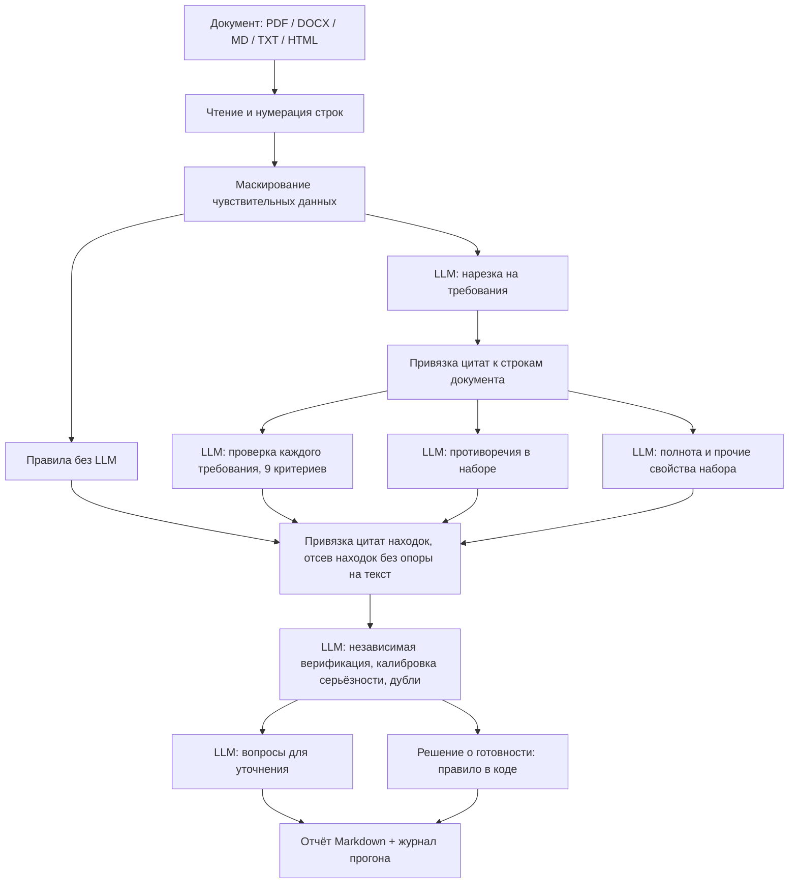

# Агент проверки требований

ИИ-агент для статического ревью документа с требованиями до начала разработки. Читает документ (PDF, DOCX, Markdown, TXT, HTML), выделяет отдельные требования, проверяет каждое и весь набор по ISO/IEC/IEEE 29148:2018 (п. 5.2.5, 5.2.6) и IEEE Std 830-1998 (п. 4.3), формулирует вопросы для уточнения и пишет отчёт на русском языке.

Задача: BCC-HUB x MNU FinTech Hackathon, «Агент проверки требований».

## Быстрый старт

**1. Ключ модели.** Откройте [aistudio.google.com/apikey](https://aistudio.google.com/apikey), войдите аккаунтом Google и нажмите «Create API key». Бесплатного тарифа достаточно.

**2. Установка** (Python 3.10+):

```bash
git clone https://github.com/i-oeng/bcc-ai.git
cd bcc-ai
python -m venv .venv
# Windows: .venv\Scripts\activate    Linux/macOS: source .venv/bin/activate
pip install -r requirements.txt
```

**3. Конфиг.** Скопируйте `.env.example` в `.env` и вставьте ключ:

```bash
cp .env.example .env        # Windows: copy .env.example .env
# в .env: GEMINI_API_KEY=ваш_ключ
```

Файл `.env` в git не попадает (см. `.gitignore`).

**4. Прогон одной командой:** путь к документу и путь к отчёту.

```bash
python -m validator samples/requirements.pdf reports/report.md
```

Отчёт ляжет в `reports/report.md`. Журнал прогона (что ушло в модель и что она ответила, структурированный `result.json`) ляжет в `runs/<дата-время>/`. Если путь к отчёту не указан, отчёт пишется в `reports/<имя документа>_report.md`.

Прогон занимает 2-5 минут: агент делает около 10 запросов к модели.

## Модель

По умолчанию `gemini-2.5-flash` (Google Gemini API, бесплатный тариф). Модель задаётся в `.env` (`GEMINI_MODEL`) или флагом `--model`. Список моделей, доступных вашему ключу:

```bash
python -m validator --list-models
```

## Как устроен агент



Ключевые решения:

* **Нет общих фраз без привязки к тексту.** Модель обязана цитировать документ дословно. Код ищет каждую цитату в документе (точно, затем нечётко) и подставляет настоящий фрагмент с номером строки, разделом и страницей. Требование или находка без найденной цитаты отбрасываются, и это видно в отчёте.
* **Гибрид правил и LLM.** Детерминированные правила ловят то, что надёжнее найти кодом: размытые слова («в момент», «и далее»), незаполненные поля шаблона, отсутствие версии и приоритетов, смешение денежных единиц, изменяющие операции через GET, коды ответа без описания. LLM ищет смысловые дефекты: противоречия между требованиями и критериями приёмки, пропущенные сценарии, непроверяемые формулировки.
* **Два взгляда на каждую находку.** Отдельный проход модели работает как независимый рецензент: отклоняет домыслы, калибрует серьёзность, объединяет дубли. Отклонённые находки не пропадают молча: они перечислены в приложении к отчёту.
* **Вопросы для уточнения.** Агент не только перечисляет дефекты, но и готовит закрытые вопросы заказчику и смежным командам с вариантами ответа, приоритетом и адресатом.
* **Решение принимает код, а не модель.** «Можно ли начинать разработку» определяется правилом по подтверждённым находкам (есть критичный дефект, значит нельзя). Модель только объясняет решение и расставляет приоритеты исправлений.

## Конфиденциальность

Банковские требования часто содержат то, что нельзя отправлять во внешний сервис. Поэтому перед любым запросом к модели документ проходит маскирование на этой машине:

| Что ищется | Как проверяется |
| :--- | :--- |
| Номера карт | регулярное выражение + алгоритм Луна |
| ИИН / БИН | контрольный разряд по алгоритму РК |
| IBAN | контрольная сумма mod 97 |
| Телефоны, e-mail, IP, URL с хостом | регулярные выражения |
| Токены и ключи (JWT, Bearer, API-ключи, пароли в строках) | сигнатуры |
| ФИО | нейросеть Natasha (работает офлайн) + шаблоны «Фамилия И.О.» |
| Свои термины (названия систем, хосты) | список в файле `REDACT_TERMS_FILE` |

* Значение заменяется плейсхолдером (`[КАРТА_1]`, `[ФИО_2]`). Одно значение всегда получает один плейсхолдер, поэтому модель понимает, что речь об одной карте.
* Таблица соответствий не покидает машину; в отчёте исходные значения возвращаются на место.
* **Fail closed:** перед каждым запросом исходящий текст сканируется ещё раз. Если что-то осталось, запрос не отправляется.
* **Аудит:** `python -m validator документ.pdf --dry-run` ничего не отправляет в модель, а сохраняет в `runs/` маскированный документ и первый запрос ровно в том виде, в каком они ушли бы. Все запросы реального прогона тоже сохраняются в `runs/`.
* Суммы, даты, пороги и коды ответа не маскируются: без них нельзя проверить логику требований.

Ограничение: маскирование скрывает идентификаторы, но не бизнес-логику. Для документов, где конфиденциальна сама логика, нужен платный тариф Gemini (Google не использует такие данные для обучения) или корпоративный контур.

Пример маскирования: `python -m validator samples/requirements_with_pii.md --dry-run`.

## Отчёт

Отчёт на русском, в Markdown:

1. **Паспорт прогона:** документ, SHA-256 файла, дата, модель (и версия, которую вернул API), версия агента (git-коммит), статистика маскирования и запросов.
2. **Как агент нарезал требования:** таблица «ID в отчёте, ID в документе, место, краткая формулировка, цитата».
3. **Проверка каждого требования:** матрица 9 критериев и находки с цитатой, местом и исправлением.
4. **Проверка всего набора:** оценка по 8 критериям набора и находки.
5. **Вопросы для уточнения:** блокирующие, важные, желательные; кому задать, почему важно, варианты ответа.
6. **Сводка:** число требований и нарушений по серьёзности и критериям, список критичных дефектов (противоречивые, непроверяемые, неполные).
7. **Итог:** можно ли начинать разработку и тестирование, что исправить в первую очередь.

Приложения: методика, отклонённые верификатором находки, объединённые дубли.

## Критерии

| Уровень | Критерии | Источник |
| :--- | :--- | :--- |
| Требование | необходимость, уместность уровня, однозначность, полнота, единичность, выполнимость, проверяемость, корректность, соответствие оформлению | ISO/IEC/IEEE 29148 п. 5.2.5; IEEE 830 п. 4.3 |
| Набор | полнота, непротиворечивость, выполнимость, понятность, возможность валидации, прослеживаемость, ранжирование, модифицируемость | ISO/IEC/IEEE 29148 п. 5.2.6; IEEE 830 п. 4.3 |

Серьёзность: критично (блокирует разработку или тесты), существенно (высокий риск неверной реализации), незначительно (оформление).

## Параметры

```text
python -m validator ВХОД [ОТЧЁТ] [--model M] [--batch-size N] [--dry-run] [--no-redact] [--list-models]
```

| Переменная `.env` | Назначение | По умолчанию |
| :--- | :--- | :--- |
| `GEMINI_API_KEY` | ключ Gemini | обязательно |
| `GEMINI_MODEL` | модель | `gemini-2.5-flash` |
| `GEMINI_TEMPERATURE` | температура | значение модели |
| `REDACT_ENABLED` | маскирование | `1` |
| `REDACT_NER` | поиск ФИО через Natasha | `1` |
| `REDACT_TERMS_FILE` | файл своих терминов для маскирования | не задан |
| `VALIDATOR_BATCH_SIZE` | требований в одном запросе | `8` |
| `VALIDATOR_TZ` | часовой пояс даты в паспорте | `Asia/Almaty` |

## Качество

Тесты (без сети, с поддельной моделью):

```bash
python -m pytest -q
```

Оценка полноты по размеченному вручную эталону дефектов (`eval/gold.json`):

```bash
python eval/score.py runs/<прогон>/result.json
```

## Структура

```text
validator/
  cli.py        командная строка
  pipeline.py   конвейер проверки
  loader.py     чтение PDF/DOCX/MD/TXT/HTML, номера строк, разделы, страницы
  redact.py     маскирование и проверка исходящих запросов
  llm.py        клиент Gemini: JSON-схемы, повторы, журнал запросов
  prompts.py    промпты
  criteria.py   критерии ISO 29148 и IEEE 830, шкала серьёзности
  rules.py      детерминированные проверки
  grounding.py  привязка цитат к строкам документа
  report.py     отчёт
samples/        документ хакатона (MD и PDF) и пример с персональными данными
reports/        отчёт итогового прогона
eval/           эталон дефектов и скрипт оценки
tests/          тесты
```
